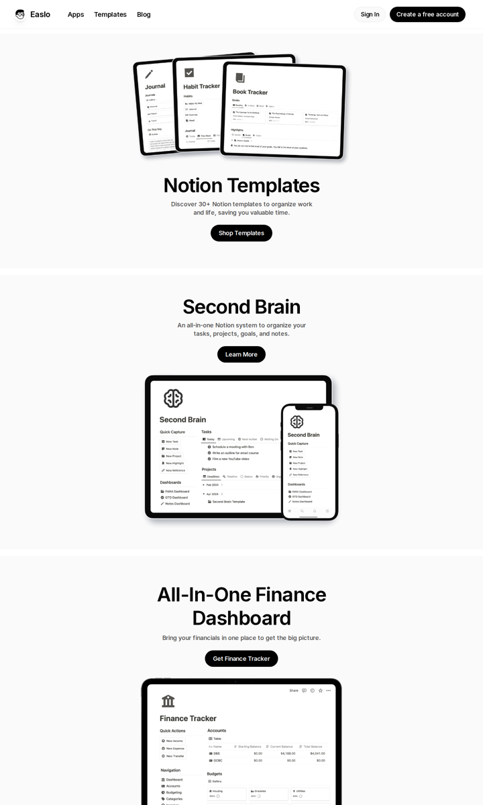

# Easlo — easlo.co

> **Papel no Comandou:** referência **secundária**, só para a apresentação de mockups em dispositivos.
> O formato é de catálogo (vários produtos), então não serve como estrutura.
> Extraído em 2026-10-27. Dados brutos em `raw/easlo.json`. Stack: Framer.



## Tokens
- **Cor:** monocromática. `#FFF` · `#FAFAFA` (fundo de seção) · `#F0F0F0` · `#E3E3E3` · `#888` · `#6B6B6B` (texto secundário) · `#484848` · `#000` (texto e botões).
- **Tipo:** Inter Variable. H1 de seção **58/69.6, peso 400, tracking -1.5px**; lead 18/25.2/500 em `#484848`; nav 20/28; botão 18/400.
- **Raio:** **56px** nos painéis de seção (cards enormes arredondados), `100px` nos botões pill, `50%` em avatares, 12px em itens menores.
- **Sombras em camadas** (padrão Framer, bem suave):
  ```css
  box-shadow: 0 .8px .8px -.94px #00000017, 0 2.4px 2.4px -1.9px #00000014,
              0 6.4px 6.4px -2.8px #00000012, 0 20px 20px -3.75px #00000008;
  ```
- **Layout:** cada produto ocupa um painel `#FAFAFA` com raio 56 e `padding 80px`, separado do vizinho por um gap branco, com tudo centralizado (título, sub, botão preto e mockup).
- **Breakpoints:** 810 / 1200 (padrão Framer).
- **Motion:** quase nenhum, só aparece no carregamento.

## O que aproveitar
- **Mockup em device composto:** tablet com celular sobreposto mostrando a mesma tela em dois tamanhos. Para o Comandou: **tablet com a tela da Cozinha e celular com a tela do Garçom** na mesma imagem.
- **Painel de seção arredondado** (raio grande, fundo levemente diferente). Combina com a linguagem arredondada do b-system se o raio ficar em 24–32px.
- **Sombra em camadas** para os mockups flutuarem sem sombra pesada.

## Evitar
- Estrutura em catálogo, com H1 repetido em toda seção (semântica ruim).
- Ausência de cor e de personalidade.
