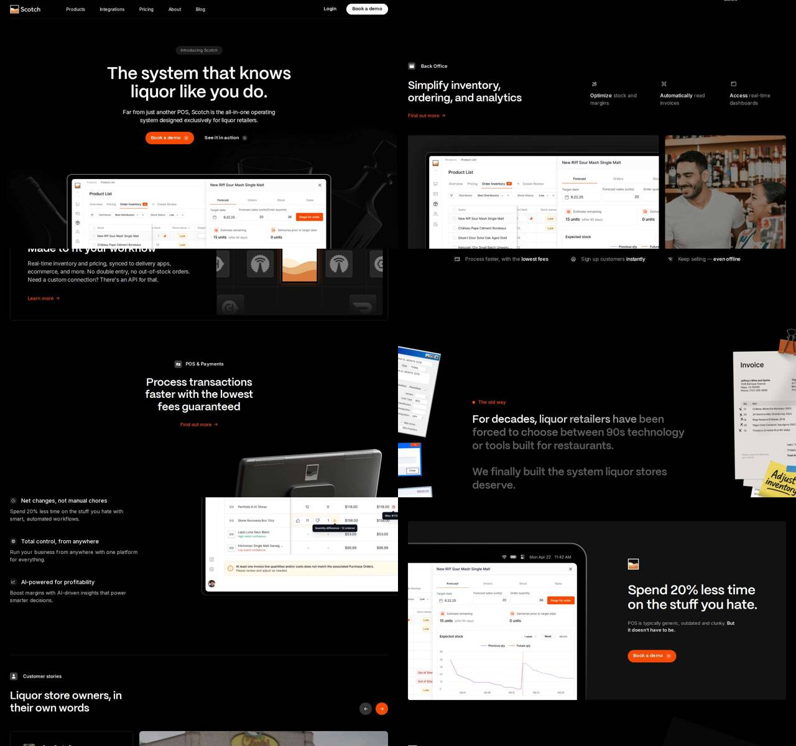

# Scotch — scotchpos.com

> **Papel no Comandou:** referência de **estrutura, narrativa e padrões de UX**.
> Mesmo tipo de produto (sistema operacional/PDV para um nicho de varejo físico), mesmo público (dono de pequeno negócio).
> Extraído em 2026-10-27 do site ao vivo, com valores computados no navegador a 1440×900. Dados brutos em `raw/scotch.json`.

Stack: Next.js (pages router) + Tailwind + framer-motion (`whileInView`) + react-fast-marquee.

---

## 1. Tokens

### Cores
Tema escuro único. Uma cor de acento só.

| Token (nome nosso) | Valor | Uso |
|---|---|---|
| `bg` | `#000000` | fundo de todas as seções |
| `surface-1` | `#111111` / `#141413` | cards, mock frames |
| `surface-2` | `#1A1A1A` | aba ativa, card hover |
| `surface-3` | `#292929` / `#333` / `#3E3E3E` | bordas, divisores |
| `fg` | `#FFFFFF` | títulos e texto principal |
| `fg-muted` | `#999999` (`rgb 153`) | descrições de features |
| `fg-subtle` | `rgba(255,255,255,.4–.6)` | labels, legendas |
| `accent` | `#F54900` | CTA primário, links "Find out more", dot da eyebrow |
| `glass` | `rgba(255,255,255,.2)` / `.3` | chips de carrossel, botões de seta |

Bordas são feitas com **ring inset** em vez de `border`:
`box-shadow: inset 0 0 0 1px rgba(255,255,255,.08)` (card) · `inset 0 0 0 1px rgba(255,255,255,.16)` (tab/pill).

Gradientes só para fade de borda: `linear-gradient(#111, transparent)` em cima e embaixo de mockups.

### Tipografia
Duas famílias: **display** (Mori, geométrica, 600) e **texto** (Inter Variable).

| Papel | Família | Tamanho / LH | Peso | Tracking |
|---|---|---|---|---|
| H1 hero | Mori | 54 / 59.4 (1.1) | 600 | normal (variante -1.08px) |
| H2 seção (CTA final) | Mori | 42 / 46.2 | 600 | normal |
| H2 seção | Mori | 34 / 39.8 (1.17) | 600 | normal |
| Lead (sub do hero) | Inter | 18 / 26.1 | 400 | -0.18px |
| Título de feature | Inter | 18 / 27 | 500 | normal |
| Body | Inter | 16 / 24 | 400 | +0.08px |
| Nav / botão | Inter | 15 / 22.5 | 500 | normal |
| Small | Inter | 13–14 / 19.5–21 | 400 | +0.14px |

Escala efetiva: **13 · 14 · 15 · 16 · 18 · 34 · 42 · 54**. Há um salto grande entre texto (≤18) e display (≥34), sem tamanhos intermediários.

### Espaço e layout
- Container: `max-width: 1216px` centralizado, gutters `px-4 → px-8`.
- Ritmo vertical: seção com `padding-block: 164px` no desktop e 88px no hero; seções coladas usam `0 / 128–164px`.
- Gaps: 8 · 10 · 12 · 14 · 20 · 32 · 40 · 48 (grid de features) · 66–84 (colunas grandes).
- Header fixo de **60px** (`--header-height: 3.75rem`), `z-50`, fundo preto sólido sem blur.
- Breakpoints (Tailwind + custom): 360 · 400 · 640 · 768 · 880 · 1024 · 1280 · 1440.

### Raio e sombra
- `9999px` (o mais usado): botões, pills, chips, avatares.
- `16px`: cards grandes e frames de mockup. `6–10px`: tabs, inputs, mini-cards.
- Sombras de elevação quase não existem: a separação vem de ring de 1px e diferença de superfície.

---

## 2. Motion

| Padrão | Implementação | Valores |
|---|---|---|
| **Reveal ao rolar** | framer-motion `whileInView`, `once` | `opacity 0→1`, `translateY 32px→0`, **0.5s**, `cubic-bezier(.61,1,.88,1)` (easeOutSine). Ícones de feature entram com `scale .4→1` |
| Stagger | filhos do grid de features | delay em cascata, ~0.1s |
| Transições de UI | Tailwind default | `0.2s cubic-bezier(.4,0,.2,1)` em opacity/color/transform; `0.5s` em bg+shadow de cards |
| **Seta do CTA** | ícone ↗ rotacionado 45° vira → no hover | `rotate(-45deg) → rotate(0)`, 0.3s |
| Link "Find out more →" | seta desliza | `translateX(0 → 2px)`, 0.2s |
| Nav hover | escurece o texto | `#FFF → #999` |
| **Marquee de logos** | react-fast-marquee | `translateX(0 → -100%)` linear infinito; 18.9s (faixa curta, 4 itens) e 113.6s (faixa longa, 12 itens) |
| Ícone "wave" | `@keyframes wave` | rotate 360° contínuo (blob decorativo) |
| Vídeo | `<video autoplay muted playsinline>` sem loop | demo do POS na seção de pagamentos |

⚠️ Sem nenhuma regra `prefers-reduced-motion`. Não copiar esse ponto.

---

## 3. Componentes

**Header**: logo · nav com dropdown "Products" (mega-menu de 2 itens com título e subtítulo, ícone ↗) · "Login" (texto) · "Book a demo" (pill branco/laranja).

**Eyebrow pill**: "Introducing Scotch" com pill escuro, ring 1px branco/16% e texto 13px muted, acima do H1.

**Botões**
- Primário: pill `#F54900`, texto branco 15/500, `padding ~10px 18px`, ícone circular ↗ dentro do botão à direita.
- Secundário: texto branco com ícone ▶ em círculo ("See it in action").
- Link de seção: laranja, 15/500, seta → ("Find out more →").

**Product tabs (hero)**: segmented control `Checkout · Ordering · Receiving · Analytics` com botões `rounded-md`, ring branco/16%, ativo em `#1A1A1A`. Embaixo fica o mockup da tela, que troca conforme a aba. No mobile vira wrap de pills acima da imagem.

**Feature trio**: ícone 20px + **título em branco + complemento em cinza na mesma linha** ("**Optimize** stock and margins"). Três colunas à direita do H2 da seção.

**Mockup frame**: screenshot real do produto dentro de um frame escuro de raio 16, com fade de gradiente na borda inferior, às vezes sobreposto a uma foto de pessoa (dono e cliente sorrindo).

**Bloco "old way / new way"**: eyebrow com dot laranja e texto grande (34px) em que uma parte fica em branco e o resto em cinza 40%. Ao redor, colagem de "papéis velhos" (invoice, post-it "Adjust inventory", janela Windows 98) inclinados.

**Benefícios ×3**: ícone + título 16/500 + descrição muted, empilhados, ao lado de um mockup grande.

**Depoimentos**: carrossel com setas circulares (cinza glass e laranja), card com foto, citação, nome, cargo, empresa, cidade e link "Watch video".

**CTA final**: logo-símbolo, H2 42px "Spend 20% less time on the stuff you hate.", subtítulo, botão primário, mockup em tablet ao lado.

**Trust strip**: três microbenefícios com ícone em linha ("Process faster, with the **lowest fees**").

---

## 4. Estrutura da página (ordem real)

1. Hero: eyebrow, H1, lead, 2 CTAs, tabs de produto e mockup.
2. Marquee "Designed with support from top retailers".
3. Back Office: H2 + feature trio + mockup e foto + métrica ("20% less time…").
4. Integrações: "Made to fit your workflow", grade de logos animada.
5. POS & Payments: H2 centralizado, vídeo, trust strip.
6. Old way / New way.
7. Três benefícios + mockup de invoice.
8. Depoimentos.
9. CTA final.
10. Footer.

## 5. UX: o que vale reaproveitar
- **Um CTA só** em toda a página ("Book a demo"), repetido 4 vezes.
- **Produto real à mostra**: todo bloco tem screenshot de verdade, nada de ilustração genérica.
- **Comparação antes/depois** que nomeia a dor do público.
- **Métrica concreta** ("20% less time") repetida no meio e no fim.
- Prova social em vídeo, com nome e cidade da loja.
