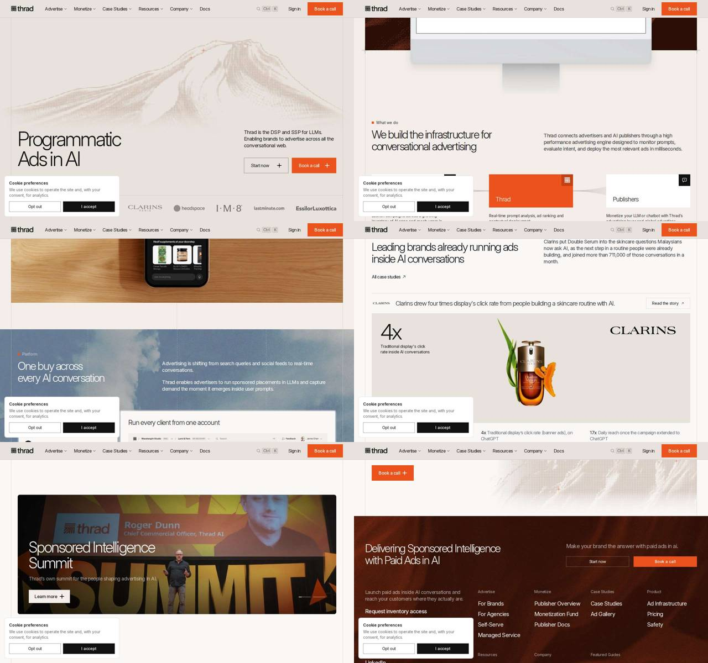

# Thrad — thrad.ai

> **Papel no Comandou:** referência de **paleta, sistema de tokens e motion**.
> O fundo creme com acento laranja-terracota é praticamente a paleta do b-system. O site também expõe um sistema de tokens CSS completo e bem nomeado.
> Extraído em 2026-10-27 do site ao vivo. Dados brutos em `raw/thrad.json`.

Stack: Astro (ilhas React), CSS próprio com custom properties, reveal via IntersectionObserver e `[data-motion-rise]`. Suporta `prefers-reduced-motion`.



---

## 1. Tokens (custom properties reais do site)

### Cor: primitivas
```css
--accent-50:#fdf0ea; --accent-200:#f8c4ac; --accent-400:#f0865a;
--accent-500:#ec521b; --accent-600:#c43f12; --accent-800:#8e2c0b;
--ink-900:#111112; --ink-700:#3a3a3c; --ink-500:#6e6e73; --ink-300:#a1a1a6;
--ground-50:#f9f8f7; --ground-100:#f2ede9; --ground-200:#e8e2dc;
--ember-700:#3b170c; --ember-800:#2a0e07; --ember-900:#1f0a04;
--line-hairline:#0a0a0a1f; --line-strong:#0a0a0a3d; --line-emphasis:#0a0a0a73;
```

### Cor: semânticas
```css
--color-page: var(--ground-100);            /* fundo principal */
--color-page-secondary: var(--ground-50);   /* seções alternadas */
--color-surface: #fff;                      /* cards */
--color-surface-sunken: var(--ground-200);  /* hero, header */
--color-heading / --color-body: var(--ink-900);
--color-secondary: var(--ink-700);
--color-muted: var(--ink-500);
--color-accent: var(--accent-500);
--color-accent-hover: var(--accent-600);
--color-accent-pressed: var(--accent-800);
--color-accent-surface: var(--accent-50);
--color-border: var(--line-hairline);       /* 12% preto */
--color-border-strong: var(--line-strong);
--color-canvas: var(--ember-800);           /* footer e bloco escuro */
--color-surface-glass: #f9f8f76b;           /* + backdrop-filter blur(8–12px) */
--color-terrain-deep..highlight: #866b5b → #e8e2dc;  /* ilustração */
```
**Padrão:** alternância de faixas `ground-200 → ground-100 → ground-50`, com um bloco escuro "ember" (marrom-avermelhado, não preto) no footer. O resultado é quente e sem contraste duro.

### Tipografia
Uma família só: **Inter Variable**, com peso **300 nos títulos** e tracking bem negativo. A "elegância" vem daí.

| Token | Tamanho / LH | Tracking | Peso |
|---|---|---|---|
| `--text-display-hero` | `clamp(44px, 5.6vw, 82px)` / 1.01 | **-0.065em** | 300 |
| `--text-display-2xl` | 48 / 48 | -0.05em | 300 |
| `--text-display-xl` | 38 / 34.2 | -0.063em | 300 |
| `--text-display` (H2) | 36–40 / ~1.07 | -0.05 a -0.06em | 300 |
| `--text-h3` | 21–22 / 28 | -0.04em | 300 |
| `--text-title` | 24 / 29 | -0.01em | 400 |
| `--text-stat` | 38 / 1.08 | -0.063em | 300 (números "4x", "17x") |
| `--text-body-lg` | 17 / 24 | -0.03em | 400 |
| `--text-body` | 16 / 22 | -0.028em | 400 |
| `--text-caption` | 14 / 20 | -0.01em | 400–500 |
| `--text-index` | 13 / 16 | +0.04em | mono, numeração "1 2 3 4" |
| `--text-micro` | 11 / 1.4 | +0.04em | 500, eyebrow |

### Espaço, layout, raio, sombra
```css
--space-1..32: 4 8 12 16 20 24 32 40 48 64 80 96 128;
--space-section: 64px; --space-section-lg: 80px; --band: 96px; --band-lg: 128px;
--container-page: 1280px; --gutter: 20px;
--rail-measure: min(100% - 2*var(--gutter), 1280px - 2*var(--gutter));
--site-header-height: 64px;
--radius-none:0; --radius-sm:4px; --radius-md:8px;   /* + 999px em pills */
--shadow-raised: 0 1px 2px #0a0a0a14, 0 1px 3px #0a0a0a0a;
--shadow-float: 0 1px 3px -1px #1111120f, 0 8px 24px -8px #1111121a;
--bp-tablet: 810px; --bp-desktop: 1200px;
```
**Botões são retos (radius 0)**, assim como os cards (4px). Esse ar editorial é o oposto do b-system arredondado, então **não** vamos adotar.

---

## 2. Motion (tokens reais)

```css
--duration-fast:.15s; --duration-base:.2s; --duration-slow:.4s;
--ease: cubic-bezier(.44,0,.56,1);            /* UI: hover, cor, bg */
--duration-rise:.6s;  --ease-rise: cubic-bezier(.22,1,.36,1);   /* easeOutQuint */
--duration-fade:.7s;  --ease-fade: cubic-bezier(.25,0,.4,1);
--duration-draw:2.5s; --ease-draw: cubic-bezier(.45,0,.55,1);   /* linhas SVG */
--duration-grow:.7s;  --ease-grow: cubic-bezier(.34,1.4,.64,1); /* overshoot */
--rise-offset: 24px;  --grow-lead: .18s;
```

| Padrão | Como funciona |
|---|---|
| **Rise on scroll** | `[data-motion-rise]` começa com `opacity:0; transform:translateY(24px)`. O IntersectionObserver adiciona a classe e transiciona `opacity .7s ease-fade, transform .6s ease-rise`. Aplicado em heading, board, steps, vídeo, bento e listas, cada bloco por si |
| **Fluxo animado em SVG** | diagrama "Advertisers → Thrad → Publishers": paths curvos com `pathLength=100`. Um pulso luminoso percorre a linha com `@keyframes wwd-pulse-in/out` (3.4s, infinito), animando uma custom property `--wwd-p` via `stroke-dashoffset` |
| **Progress fill** | `@keyframes flow-fill { to { transform: scaleY(1) } }`, 7s linear, barra que acompanha os passos 1-2-3-4 |
| Typing / chat | `imsg-dot` (três pontinhos piscando), `term-blink` (cursor), `term-shimmer` (texto com brilho), no mock de chat |
| Link hover | cor e borda vão para `--accent-500`, com `text-underline-offset` animado em 0.4s |
| Flex-grow cards | `flex-basis .6s ease-rise`: card de case expande no hover/ativo |
| Mega-menu | `clip-path + opacity + visibility .2s` |
| Reduced motion | `@media (prefers-reduced-motion: reduce)` desliga rise e pulse |

---

## 3. Componentes
- **Header sticky** 64px, fundo `ground-200`, hairline inferior, nav com mega-menu, busca `Ctrl K`, "Sign in" e CTA laranja reto.
- **Hero split**: H1 enorme e leve à esquerda, texto e dois botões à direita; ilustração de "montanha" em pontilhado (canvas `DotMountain`) no fundo; faixa de logos de clientes em cinza no rodapé do hero.
- **Botões**: primário com `bg accent-500`, `padding 16px 24px` (56px de altura) ou `12px 20px` (48px), ícone `+`. Secundário com borda 1px `line-emphasis` em fundo transparente.
- **Eyebrow**: quadradinho laranja de 6px + texto 14px ("■ What we do").
- **Diagrama de fluxo**: três cards (o do meio laranja e sólido) ligados por linhas SVG com pulso. É o componente mais relevante para o Comandou (Garçom → Cozinha → Caixa).
- **Steps numerados**: 1 Build · 2 Launch · 3 Optimize, com número em mono e barra de progresso.
- **Stat card**: número 38px/300 ("4x") + legenda 14px muted + logo do cliente + imagem do produto.
- **Bloco com foto de fundo**: céu ou foto com overlay `linear-gradient(to top, #000a, #0004 50%, transparent)` e texto claro.
- **Footer ember**: fundo marrom escuro, CTA repetido e colunas de links.
- **Cookie banner**: card branco com "Opt out" (outline) e "I accept" (preto).

## 4. O que aproveitar / evitar
- ✅ Estrutura de tokens semânticos (`page / surface / sunken / accent-hover / pressed / border-hairline`) e o **sistema de motion tokenizado**.
- ✅ Alternância de faixas creme e um bloco escuro quente (ember) em vez de preto.
- ✅ Diagrama de fluxo com pulso em SVG.
- ❌ Peso 300 com tracking -0.065em em Inter: não funciona com a Nunito, que é arredondada e pesada. Manter a Nunito em 700–800.
- ❌ Raio 0. O b-system é arredondado (8–16px, pills).
